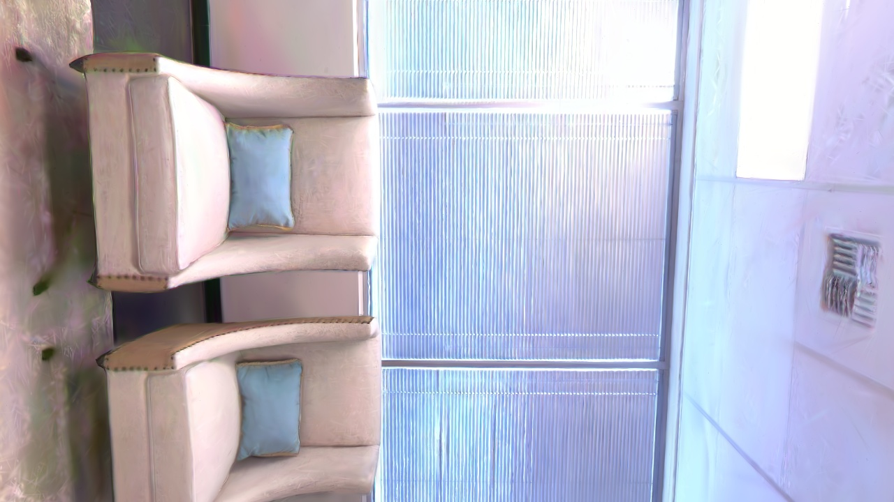
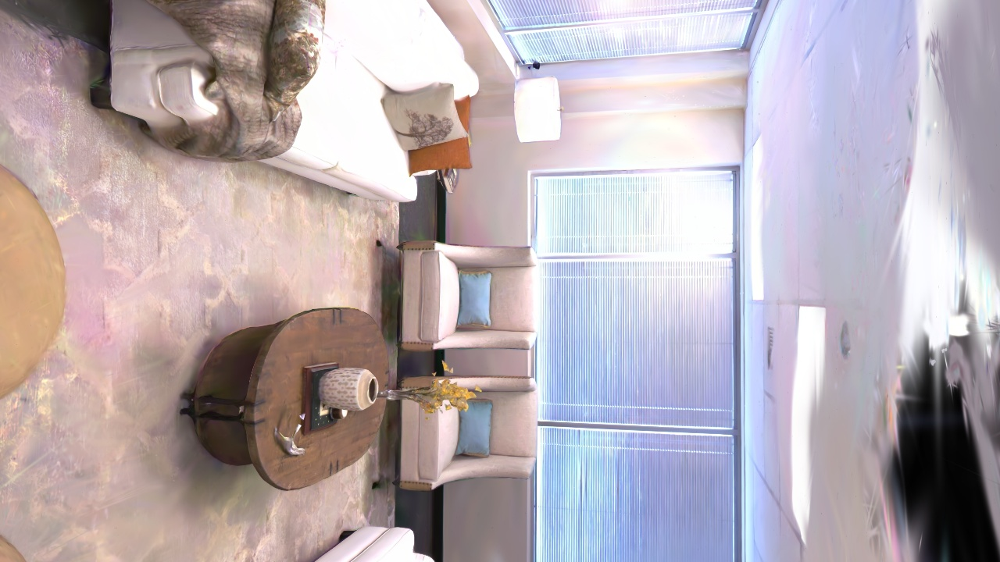
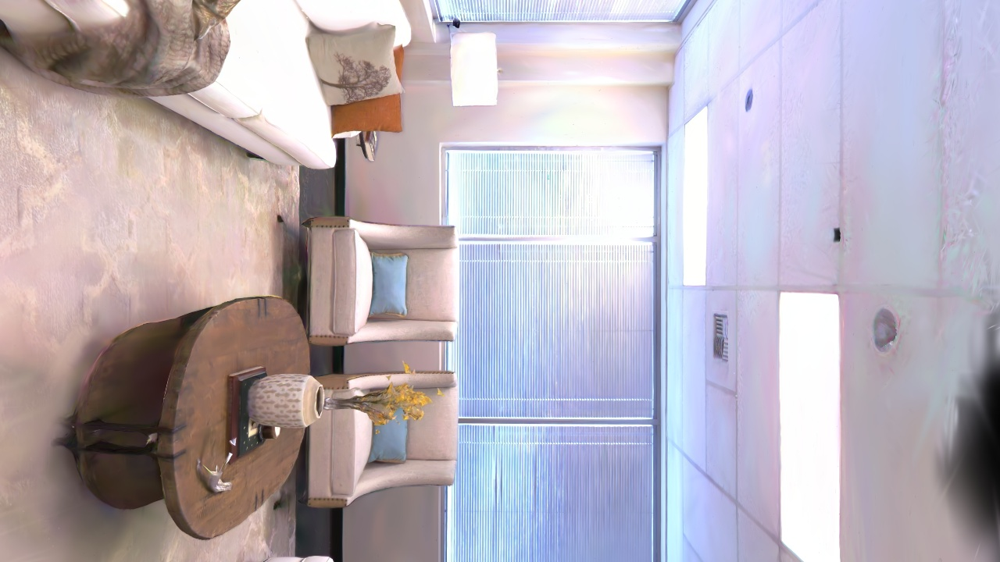

# GSS Real-time Rendering E2E Demo

**Date**: 2026-03-14
**GPU**: NVIDIA GeForce RTX 5080 Laptop GPU
**Scene**: point_cloud_jh.ply (1,401,209 Gaussians, SH degree 3)
**Platform**: WSL Ubuntu 22.04 (Windows 11)

## Pipeline Overview

```
PLY File (140만 Gaussians, 347MB)
  → torch checkpoint (.pt, 330MB, full SH)
    → gRPC Server (protobuf)
      → LoadModel (GPU VRAM 316MB)
        → RenderRGB (카메라 포즈 → gsplat rasterization → JPEG)
          → WebSocket Stream (브라우저)
```

## Interior Rendering (1280x720, 실내 카메라)

실내 씬이므로 카메라를 방 안쪽에 배치하여 렌더링.

| View | Size | Latency |
|------|------|---------|
| room_center | 222.5KB | 11ms |
| corner_1 (거실 전체) | 241.2KB | 17ms |
| hallway (복도) | 216.9KB | 14ms |
| close_wall (테이블 클로즈업) | 217.6KB | 17ms |






## Multi-resolution Benchmark

| Resolution | Latency | FPS | JPEG Size |
|------------|---------|-----|-----------|
| 320x240 (preview) | 10.1ms | **99 FPS** | 11.9KB |
| 640x480 (SD) | 11.2ms | **89 FPS** | 31.6KB |
| 960x540 (qHD) | 13.8ms | **72 FPS** | 48.5KB |
| 1280x720 (HD) | 15.1ms | **66 FPS** | 72.8KB |
| 1920x1080 (Full HD) | 27.2ms | **37 FPS** | 131.9KB |


## WebSocket Streaming (640x480, 30 frames burst)

| Metric | Value |
|--------|-------|
| Frames | 30/30 |
| FPS | **76.3** |
| Bandwidth | 1.76 MB/s |
| Avg Latency | 13.1ms |
| Min Latency | 10.5ms |
| Max Latency | 16.7ms |

## Format Comparison (640x480)

| Format | Size | vs JPEG50 |
|--------|------|-----------|
| JPEG Q=50 | 17.1 KB | 1x |
| JPEG Q=75 | 24.1 KB | 1.4x |
| JPEG Q=90 | 39.1 KB | 2.3x |
| PNG | 309.4 KB | 18.1x |
| RAW RGB | 900.0 KB | 52.6x |

## Architecture

```
Browser (WebSocket)
    ↕ JSON camera pose / Binary JPEG frame
FastAPI Server (server/routes/render.py)
    ↕ gRPC protobuf (render.proto)
gRPC Render Server (server/grpc/render_server.py)
    ↕ torch + gsplat rasterization (SH degree 3)
GPU (RTX 5080 Laptop) ← 140만 Gaussians in VRAM (316MB)
```

## Notes

- **첫 프레임 ~1초**: gsplat CUDA 커널 JIT 컴파일 소요 (이후 <15ms)
- **SH degree 3**: 16 SH coefficients per Gaussian → view-dependent color 지원
- **OpenGL → OpenCV**: c2w column flip (Y,Z) 필수 — gsplat은 OpenCV convention
- **보안**: checkpoint 경로 화이트리스트 + 확장자 검증 + path traversal 차단 + TLS 지원

## Test Results

- gRPC Lifecycle: 13/13 PASSED
- Security Integration: 5/5 PASSED
- Render Performance: 6/6 PASSED
- WebSocket Streaming: 8/8 PASSED
- REST API: 3/3 PASSED
- **Total: 35/35 PASSED**
